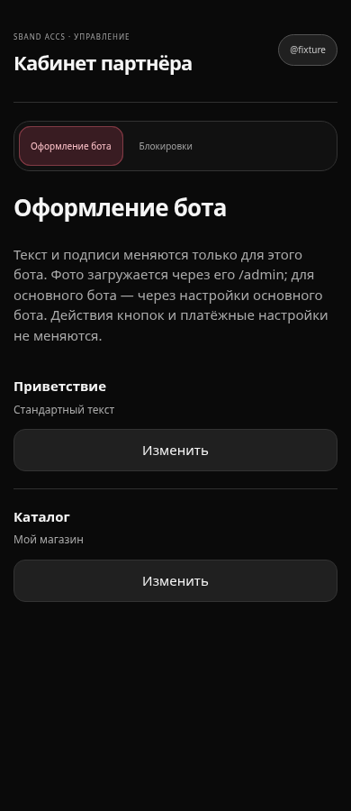

# Партнёрские боты и оформление

Один процесс основного магазина обслуживает одобренные партнёрские боты. Каталог, остатки, пользователи, подписка на канал, продажи и техработы общие. Отдельный процесс и отдельная база партнёру не нужны. Роль **Помощник** по-прежнему одна и даёт только рекламу; владение партнёрским ботом определяется заявкой, а не этой ролью.

## Подключение

1. Обновите код и зависимости, затем перезапустите основной бот. Таблицы добавляются при `init_db`, существующие данные сохраняются.
2. На сервере подготовьте **постоянный** `PARTNER_BOT_KEY`. Установщик автоматически добавляет его в существующий `.env`. Для ручного обновления: `python deploy/partner_key.py --env .env` из окружения проекта. Скрипт не выводит ключ и не меняет существующий. Если сервис использует другой EnvironmentFile, добавьте туда Fernet-ключ и сохраните резервную копию вне публичного репозитория. Без ключа заявки отключены, основной магазин продолжает работать.
3. Партнёр создаёт бота в BotFather и отправляет `/partner` **основному боту** → «Подать заявку» → токен в личный чат. Сообщение с токеном удаляется по возможности. В базе хранится только шифротекст.
4. Владелец основного бота открывает `/admin` → «Настройки» → «Партнёрские боты» или соответствующий раздел Mini App. Заявка содержит ID владельца и username бота. Только владелец магазина может одобрить запуск.
5. После одобрения менеджер автоматически запускает polling в течение примерно 5 секунд. В партнёрском боте владелец открывает `/admin`: ему доступны общая блокировка пользователей и оформление собственного бота. Работоспособность требует действующего токена и возможности обращения сервера к Telegram.

Основной токен нельзя подать как партнёрский. Закрытый бот повторно включить нельзя. Пауза останавливает обслуживание, сохраняя кошельки. Окончательное закрытие требует подтверждения и переводит остатки внесённых денег в основной бот. Существующие блокировки при паузе/закрытии сохраняются; главный владелец может снять их.

## Деньги и бонусы

- Основной денежный баланс остаётся в `users.balance`. Партнёрские денежные балансы и все новые бонусные балансы хранятся отдельно в `scoped_wallets`.
- Внешние пополнения, включая Telegram Stars, принимает **только основной бот**. Уведомления о платеже также приходят от него. В партнёрском боте «Пополнить» ведёт в основной бот с выбранным магазином.
- После оплаты пользователь сам подтверждает сумму перевода из основного денежного кошелька в партнёрский. Бонусы переводить нельзя. Подтверждение действует 15 минут; повторное нажатие не списывает деньги второй раз.
- Новые приветственные бонусы, промокоды на баланс и колесо начисляются на бонусный кошелёк текущего магазина. Правила использования промокодов и период колеса общие для пользователя. Реферальная программа общая: новые комиссии начисляются отдельно в **бонусный кошелёк основного бота**, включая комиссии с партнёрских покупок.
- При покупке сначала расходуются бонусы выбранного магазина, затем его внесённые деньги. Основной кошелёк не покрывает нехватку денег у партнёра автоматически. Источник каждого нового заказа сохраняется для возврата.
- При окончательном закрытии остаток **внесённых** денег переводится пользователю в основной денежный кошелёк ровно один раз. Неизрасходованные партнёрские бонусы аннулируются, а не превращаются в деньги. Сверка сохраняется в `partner_settlements`.
- Возврат заказа восстанавливает исходные денежную и бонусную части. Во время паузы — в кошелёк партнёра; после закрытия — в соответствующие основной денежный и бонусный кошельки. Возврат заказа не выполняет второй расчёт закрытия.
- Отрицательный основной баланс после возврата платежа/комиссии учитывается: долг нельзя обойти переводом или покупкой в другом боте.
- **Старый смешанный баланс сохраняется без пересчёта.** Исторические бонусы в `users.balance` невозможно надёжно отделить от внесённых денег, поэтому автоматически они не переименовываются и не вычитаются. Разделение гарантируется для новых начислений после обновления; это не ретроспективный аудит старых пополнений.

## Права и оформление

Владелец партнёрского бота может блокировать Telegram ID во **всём** магазине, указывая причину. Он снимает только собственную блокировку. Владелец основного бота может снять все блокировки пользователя; главных владельцев блокировать нельзя. Партнёр не получает доступ к чужим профилям, балансам, товарам, платежам, помощникам, заявкам и настройкам магазина.

«Оформление меню» позволяет менять приветствие (до 900 символов, `{name}` подставляет имя), главное фото (до 10 МБ) и подписи кнопок каталога, пополнения, профиля, поддержки, покупок, рефералов, бонусов, промокодов, правил и настроек. Действия кнопок сохраняются. «Сбросить» возвращает стандартное значение. Основному боту доступен такой же редактор в настройках; главный владелец также может редактировать партнёрские меню.

Фото хранятся в `PARTNER_ASSET_DIR/partner-assets/<bot_id>/`; по умолчанию `data/`. Для Docker задан постоянный том `/app/runtime`. Резервная копия должна включать базу, каталог изображений и ключ шифрования. Потеря ключа требует повторного подключения токенов; ротацию ключа этот выпуск не выполняет.

Mini App партнёрского магазина открывается через ссылку на основной бот. Все HTTP-сессии проверяются подписью **основного** токена. `X-Partner-ID` выбирает кошелёк и не заменяет авторизацию. Это необходимо, поскольку владелец партнёра знает свой токен. Покупки в чатах партнёрских ботов ограничены заказами соответствующего бота. Платёжные обработчики и история Stars работают только с основным ботом.

Менеджер хранит offset и аренду polling в базе, прекращает обработку при паузе/закрытии, закрывает сессии при остановке. Это не отдельный хостинг для партнёров: все боты зависят от доступности основного процесса и базы.

## Проверки

- `PYTHONPATH=tests:. python -m unittest discover -s tests`
- `node tests/partners_browser.cjs`
- `node tests/helper_advertising_browser.cjs`
- `node tests/ui_polish_browser.cjs`
- `PYTHONPATH=tests:. python tests/integration_partners.py` — только одноразовая локальная MariaDB на `127.0.0.1:13309` с пустым паролем root; создаёт уникальную тестовую базу и удаляет её. Настоящие токены, платежи и Telegram-сессии не используются.

